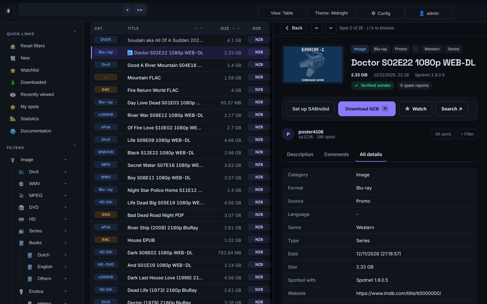
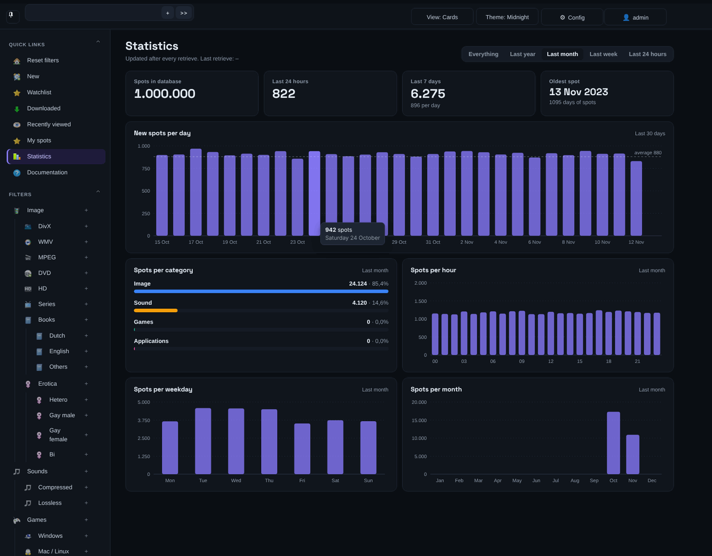
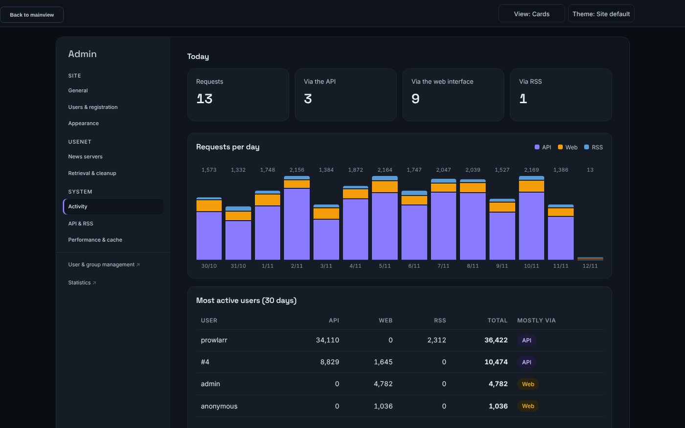
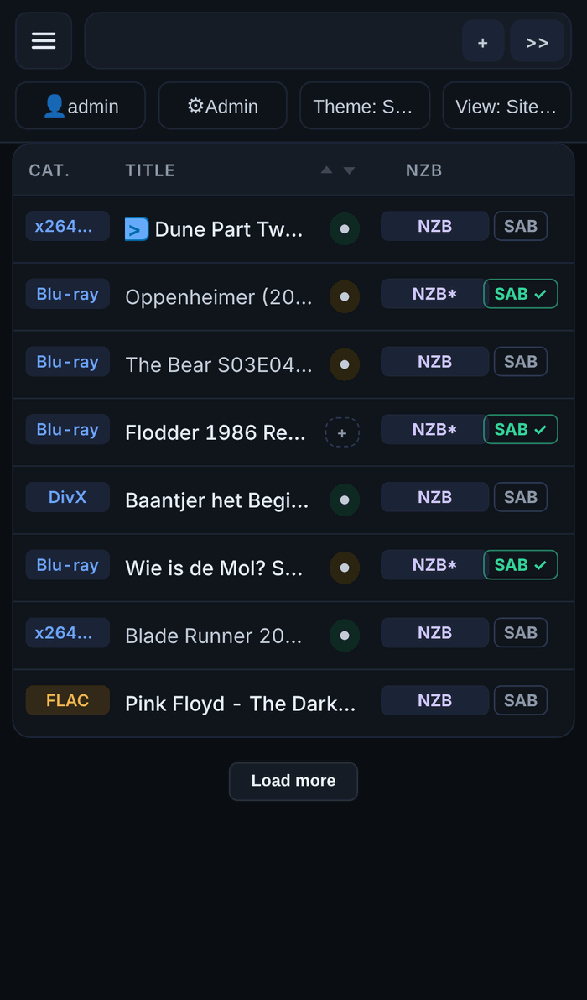

# Spotweb

🇬🇧 [English version](README.md)

Spotweb is een gedecentraliseerde usenet-community op basis van het
[Spotnet](https://github.com/spotnet/spotnet/wiki)-protocol. Het draait op een
webserver met PHP en slaat alles op in MySQL/MariaDB, PostgreSQL of SQLite.

## Wat is er nieuw in deze versie

Deze fork van de [originele Spotweb](https://github.com/spotweb/spotweb) is
gemoderniseerd en getuned voor grote databases en Prowlarr/Sonarr/Radarr.
Bekijk de **[rondleiding met screenshots](docs/CHANGES.nl.md)** en de
**[changelog per pull request](CHANGELOG.md)**.

* **Nieuwe look** – moderne huisstijl (standaard donker), vijf extra kleurthema's, kaart- of tabelweergave, verschuifbare kolommen, spotpagina naast de lijst en een echte telefoonweergave.
* **Beheercentrum** op `/admin` – alle site-instellingen in een menu links, registratie aan/uit, spots ophalen en oudere spots bijhalen met voortgangsbalk, activiteit per kanaal (API / web / RSS), API-limieten.
* **Snelle API en RSS** – zoeken in tijdvensters, een nieuwe index en een antwoordcache, zodat Prowlarr snel blijft bij 1 miljoen+ spots; `/api` werkt zonder `.htaccess`.
* **Radarr en Sonarr** – zie of een titel al in je bibliotheek staat en voeg ontbrekende titels toe bij het downloaden.
* **E-mail** – je eigen SMTP-server (STARTTLS/SSL, DKIM), testmail, wachtwoord vergeten en welkomstmail.
* **Over & updates** – versie-informatie, controleren op updates en updaten vanuit de browser, met een productiekanaal (`main`) en testkanaal (`develop`).
* **Statistieken** – interactieve grafieken in plaats van plaatjes; downloadgeschiedenis per gebruiker.
* **Onder de motorkap** – PHP 8.5, database-instellingen buiten de webroot, werkt achter Cloudflare, Engels en Nederlands.

| Statistieken | Beheer: activiteit | Telefoon |
|---|---|---|
|  |  |  |

## Installeren

1. Zorg voor een databaseserver (MySQL/MariaDB, PostgreSQL of SQLite) met een lege database `spotweb`.
2. Zorg voor een webserver met PHP (8.1 t/m 8.5) en de modules curl, dom, gettext, mbstring, xml, zip, zlib, gd en openssl.
3. Haal de code op in je webmap:
   * Productie: `git clone -b main https://github.com/rhisijmuiden/spotweb.git .` of [download de ZIP](https://github.com/rhisijmuiden/spotweb/archive/main.zip).
   * Test (nieuwste wijzigingen): `git clone -b develop https://github.com/rhisijmuiden/spotweb.git .` of [download de ZIP](https://github.com/rhisijmuiden/spotweb/archive/develop.zip).
4. Open `install.php` in je browser, los alles op wat niet `OK` is en volg de wizard.

Voor nginx, Caddy en Cloudflare: zie [docs/webserver.md](docs/webserver.md).

## Upgraden

Bij upgraden blijven je database, gebruikers en instellingen bewaard. Het
makkelijkst gaat het via **Beheer → Over & updates**: controleer op updates,
kies het kanaal en druk op *Nu bijwerken*. Met de hand: maak een back-up van de
database, werk de bestanden bij (`git pull` of de nieuwe ZIP uitpakken) en
draai `php bin/upgrade-db.php`. Zie **[docs/upgrading.md](docs/upgrading.md)**
voor de volledige handleiding (Engels).

## Problemen oplossen

Zie je een lege pagina, dan zit er meestal een fout in `ownsettings.php` of
`dbsettings.inc.php`, of in de webserverconfiguratie. Kijk in het foutlog van
je webserver voor de precieze melding.
