# Wat is er nieuw in deze Spotweb-versie

🇬🇧 [English version](CHANGES.md) · 📋 [Changelog per pull request](../CHANGELOG.md)

Deze fork van [Spotweb](https://github.com/spotweb/spotweb) heeft een compleet
nieuwe look, een volledig beheercentrum, een veel snellere API voor
Prowlarr/Sonarr/Radarr, een eigen mailserver-instelling, updaten vanuit de
browser en koppelingen met Radarr en Sonarr. Alles werkt als upgrade over een
bestaande installatie: spots, gebruikers, filters en instellingen blijven
bewaard (zie [upgrading.md](upgrading.md)).

Alle screenshots komen van een testinstallatie met voorbeelddata.

**Inhoud**

1. [Nieuwe huisstijl en thema's](#1-nieuwe-huisstijl-en-themas)
2. [Spotlijst: kaarten of tabel](#2-spotlijst-kaarten-of-tabel)
3. [Vernieuwde spotpagina](#3-vernieuwde-spotpagina)
4. [Telefoon](#4-telefoon)
5. [Statistiekenpagina](#5-statistiekenpagina)
6. [Beheercentrum](#6-beheercentrum)
7. [Gebruikersmenu en Mijn account](#7-gebruikersmenu-en-mijn-account)
8. [Snelle API en RSS](#8-snelle-api-en-rss)
9. [SABnzbd](#9-sabnzbd)
10. [Radarr en Sonarr](#10-radarr-en-sonarr)
11. [E-mail: eigen SMTP-server en wachtwoordherstel](#11-e-mail-eigen-smtp-server-en-wachtwoordherstel)
12. [Over & updates: productie- en testkanaal](#12-over--updates-productie--en-testkanaal)
13. [Onder de motorkap](#13-onder-de-motorkap)

---

## 1. Nieuwe huisstijl en thema's

Een rustige, moderne look: standaard donker, één paarse accentkleur, menu's
aan de linkerkant en de lettertypen Inter en Space Grotesk. De huisstijl staat
in `templates/modern/css/brand.css` en is beschreven in
[brand/README.md](brand/README.md).

Naast automatisch licht/donker zijn er **vijf extra kleurthema's**: Midnight,
Daylight, Ocean, Forest, Ember en Paper. De beheerder kiest de standaard in
*Beheer → Uiterlijk*; elke gebruiker kan zelf wisselen in de bovenbalk.

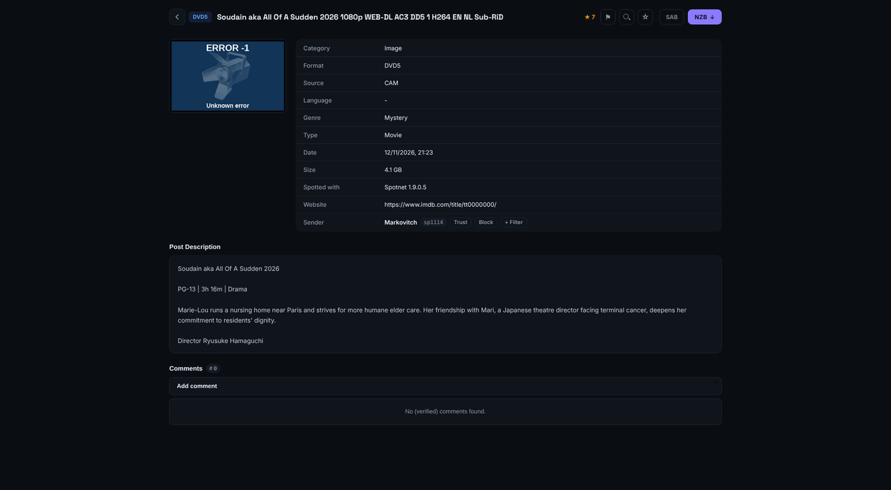

| Daylight | Ocean |
|---|---|
| 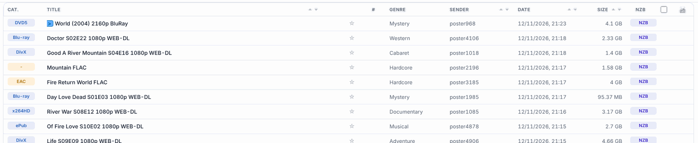 | 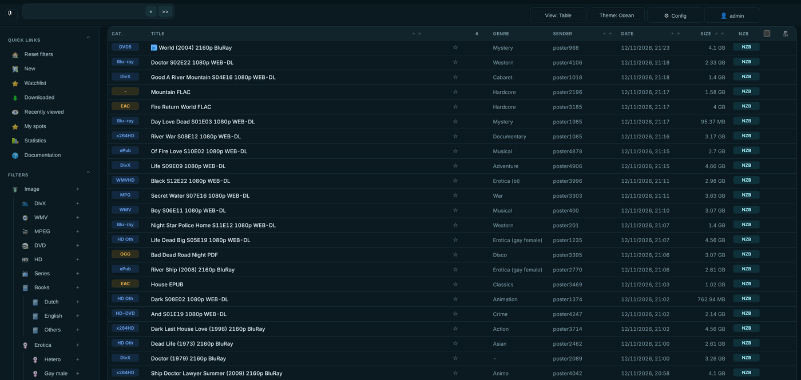 |

## 2. Spotlijst: kaarten of tabel

- **Kaarten** (posters met titel en details) of een compacte **tabel** met één regel per spot.
- De beheerder kiest de standaardweergave en kan die voor iedereen **vastzetten**.
- **Kolommen verslepen** in de tabelweergave: sleep een kolomrand, de breedtes
  worden per gebruiker onthouden, met een resetknop in de kop.
- Direct vanuit de lijst naar **SABnzbd** sturen (één klik, vinkje als het klaar is).

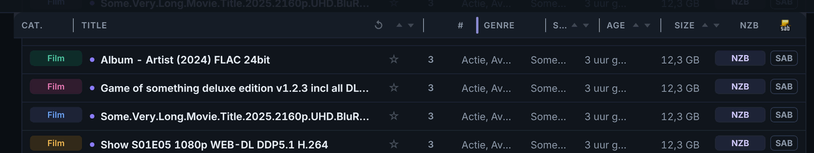

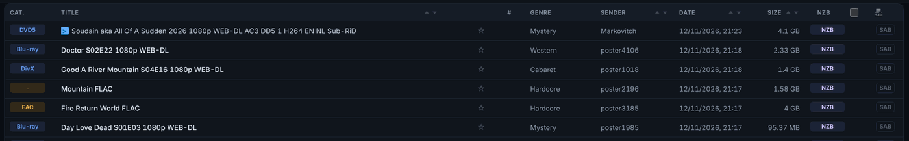

## 3. Vernieuwde spotpagina

- **Gesplitste weergave**: op brede schermen opent de spot naast de lijst;
  bladeren met `j` / `k` of de pijltjes.
- Eén **actiebalk** (Naar SABnzbd, NZB downloaden, Volgen, Zoeken).
- Tabbladen **Beschrijving**, **Reacties** en **Alle details**, met een
  rustige feitenlijst en een nette afzenderregel ("Geverifieerde afzender",
  spammeldingen).
- Geen foutmelding-popup meer als een spot niet geopend kan worden.
- Sneltoetsen reageren niet meer als je in een tekstveld typt.

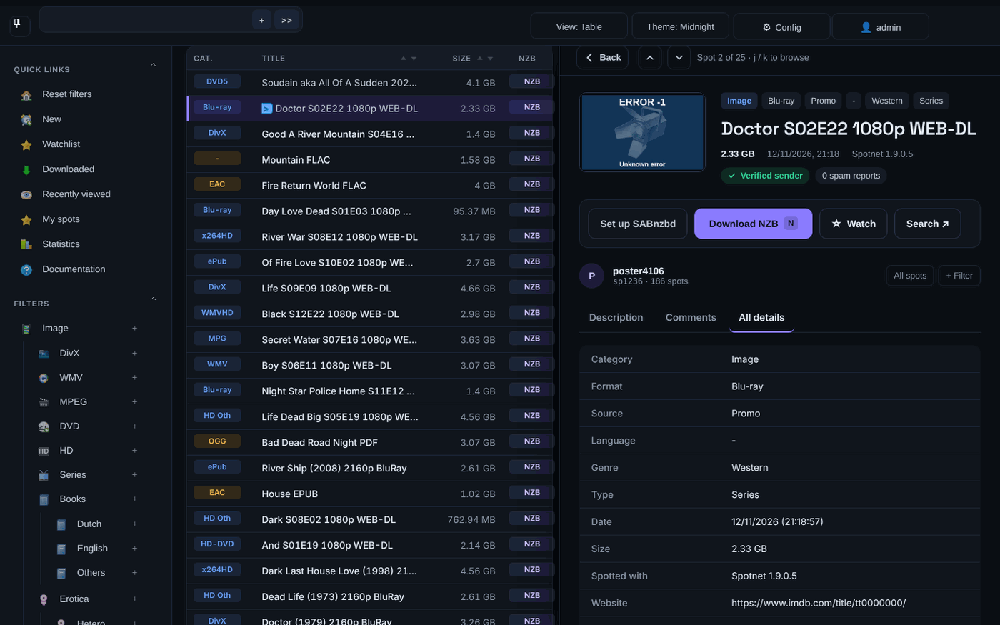

| Daylight | Volledige pagina |
|---|---|
| 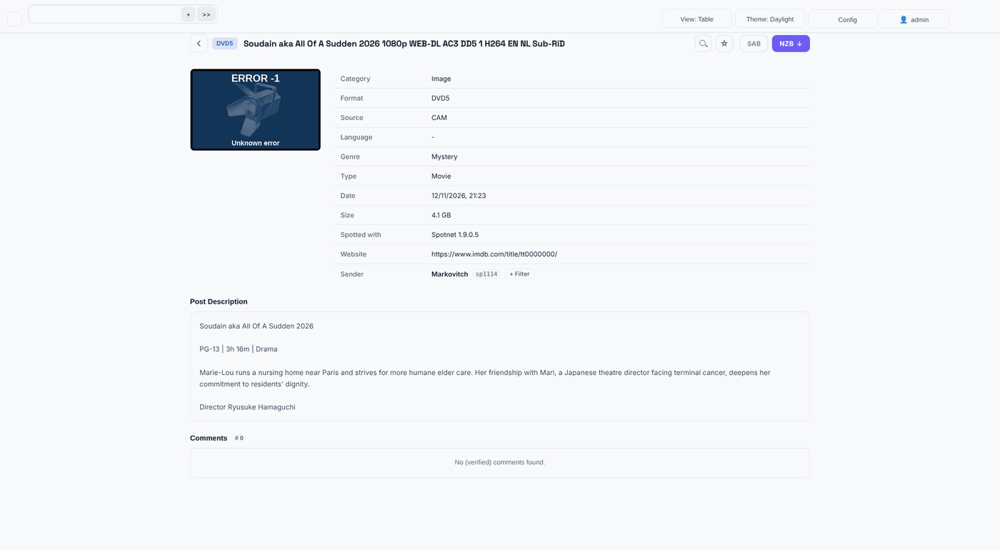 | 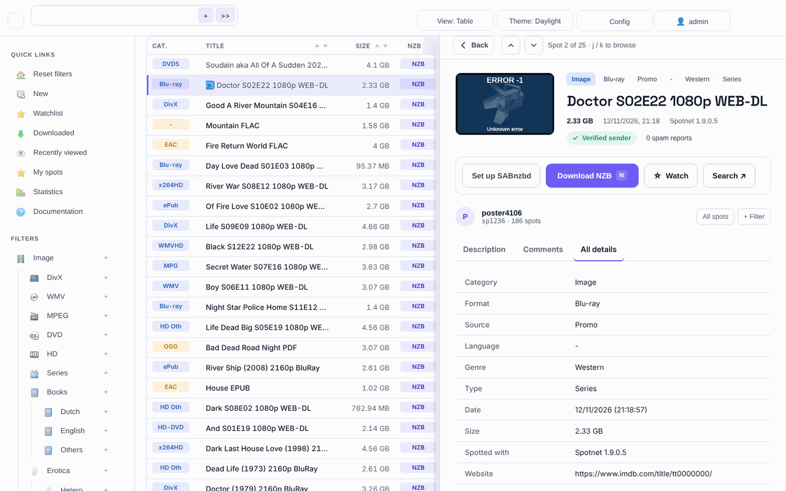 |

## 4. Telefoon

Compacte bovenbalk, een inschuifmenu, een lijst met alleen de belangrijkste
kolommen en een spotpagina met de knoppen onderin beeld.

| Lijst | Menu | Spotpagina |
|---|---|---|
| 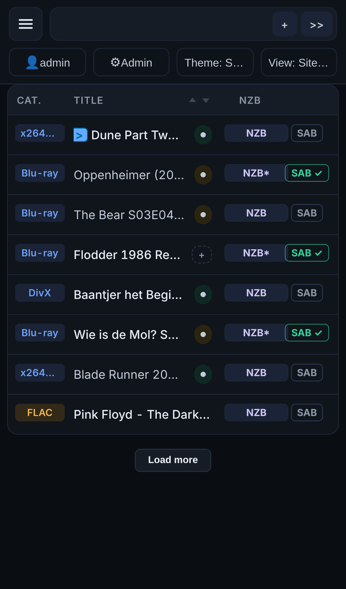 | 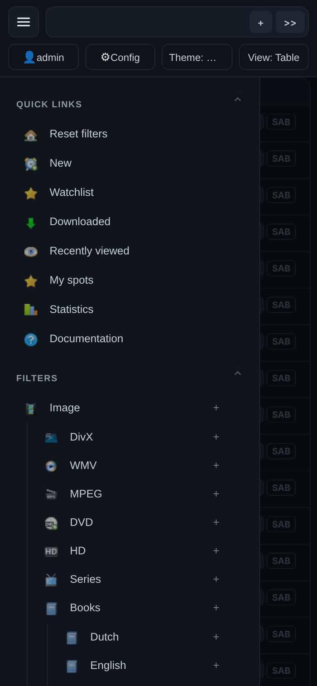 | 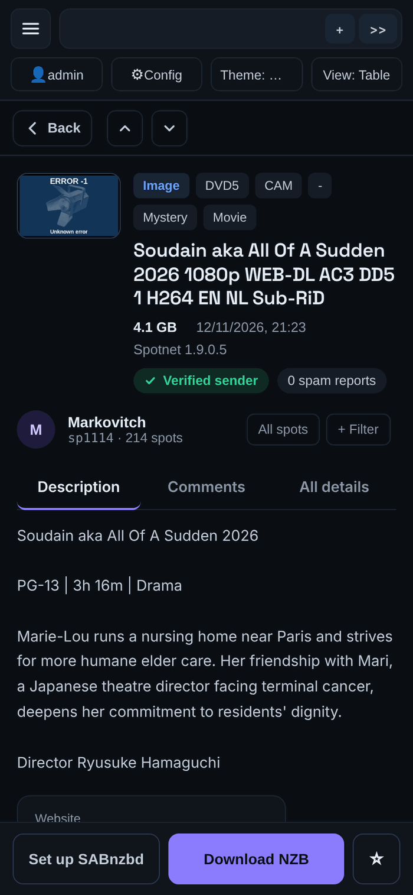 |

## 5. Statistiekenpagina

De oude statische PNG-grafieken zijn vervangen door interactieve grafieken:
nieuwe spots per dag, per categorie, per uur, per weekdag en per maand, met
periodes van "laatste 24 uur" tot "alles". Werkt in elk thema.

| Midnight | Daylight |
|---|---|
| 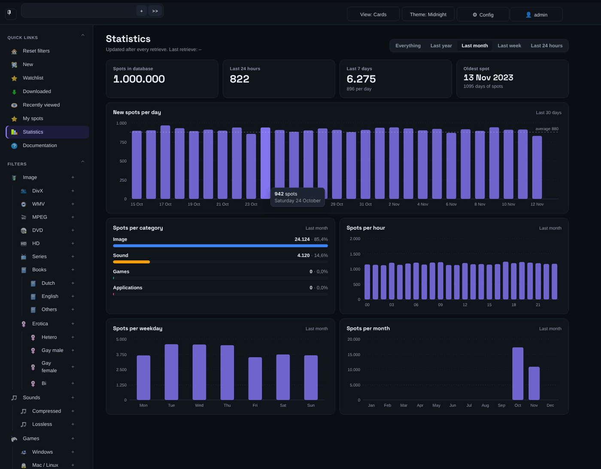 | 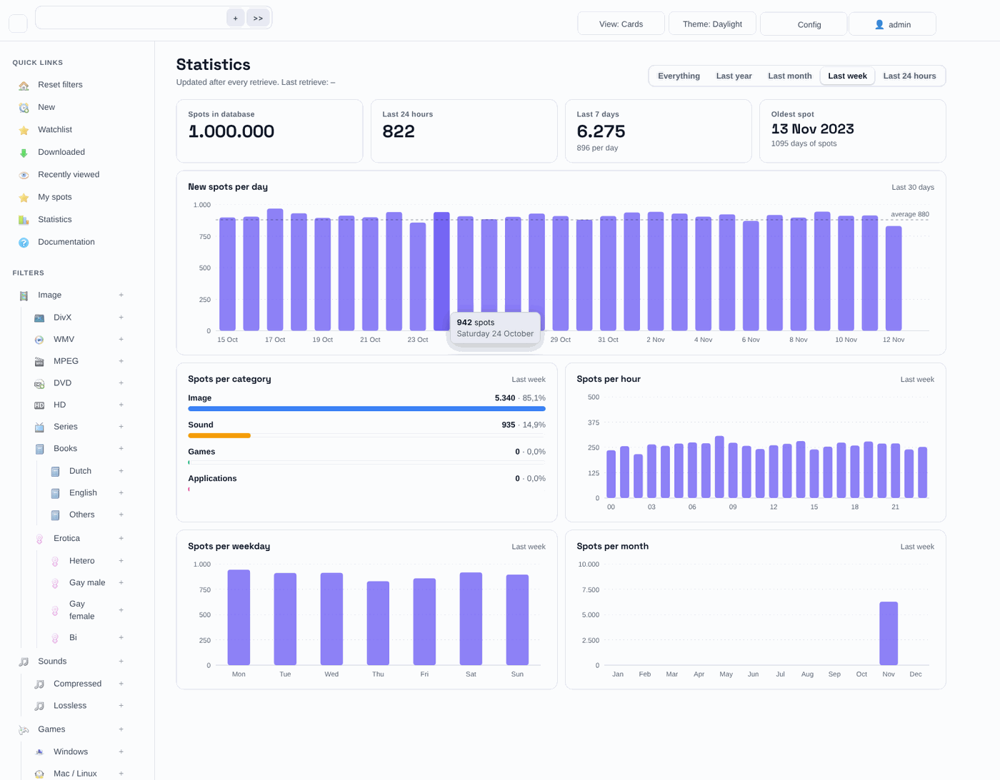 |

## 6. Beheercentrum

Alle site-instellingen op één plek via `/admin`, met het menu links:

- **Algemeen, Gebruikers & registratie** (open registratie, of alleen
  accounts die de beheerder aanmaakt), **Uiterlijk** (standaardthema en
  -weergave, eigen CSS).
- **Ophalen**: start het ophalen van spots vanuit de browser met een live
  voortgangsbalk; haal **oudere spots alsnog op** als je de startdatum
  terugzet, zonder de database te legen.
- **Nieuwsservers, Ophalen & opschonen, Prestaties & cache.**
- **Activiteit**: verzoeken per dag per kanaal (API, web, RSS), de meest
  actieve gebruikers en via welk kanaal, en de periode van de spots in de
  database.
- **API & RSS**: API en RSS-feed aan of uit, optionele limieten per
  gebruiker (throttling), antwoordcache.
- **E-mail** en **Over & updates** (zie hieronder).

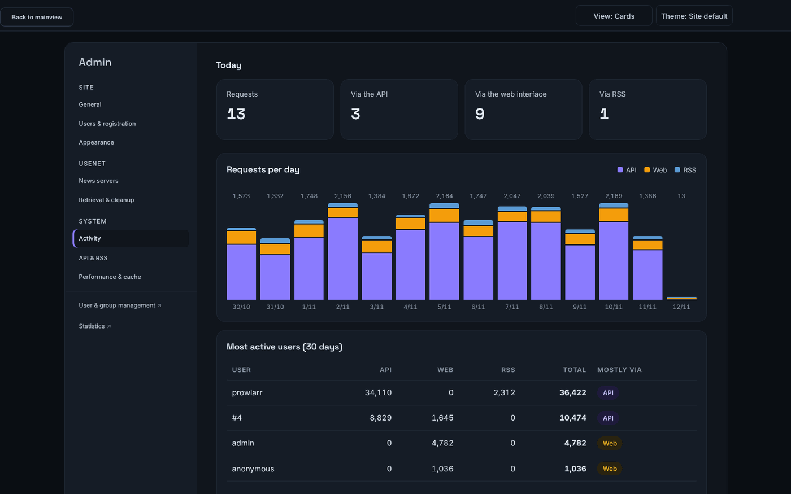

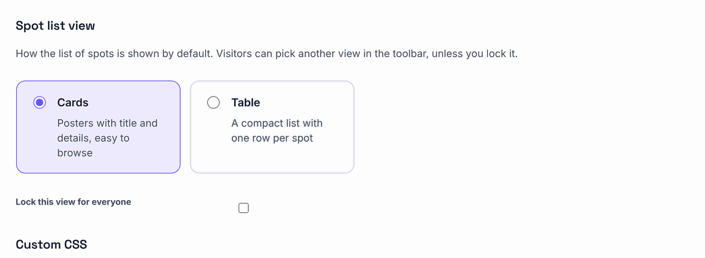

## 7. Gebruikersmenu en Mijn account

*Mijn account* zit nu in het gebruikersmenu (rechtsboven). Daar staan de
persoonlijke instellingen, de API-sleutel en een **downloadgeschiedenis** die
laat zien of je een spot zelf hebt gedownload of dat een API-programma (zoals
Prowlarr) hem heeft opgehaald.

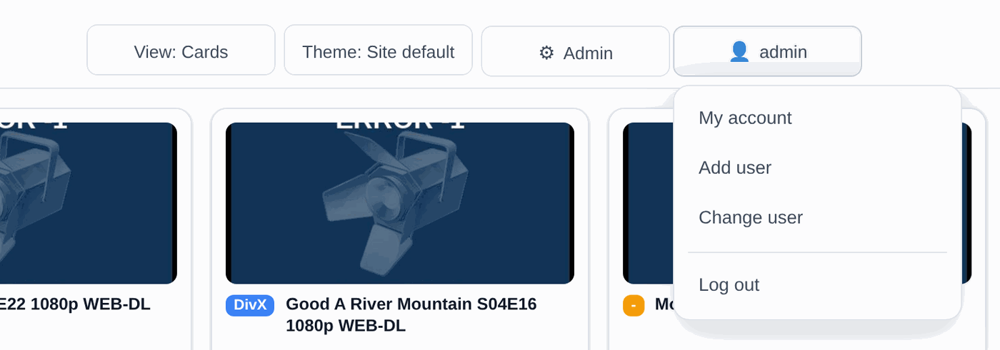

## 8. Snelle API en RSS

Gemaakt voor Prowlarr, Sonarr en Radarr op grote databases (1 miljoen+ spots):

- `/api` werkt zonder `.htaccess` of rewrite-regels.
- Zoeken naar de nieuwste spots gebeurt in tijdvensters (1 dag, 7 dagen,
  60 dagen, daarna alles) in plaats van door de hele index te lopen.
- Nieuwe database-index voor zoeken per categorie.
- Een **antwoordcache** voor API-zoekopdrachten en de RSS-feed (standaard
  10 minuten, de header `X-Spotweb-Cache` laat treffers zien); bij nieuwe
  spots wordt de cache vanzelf ververst.

## 9. SABnzbd

De SAB-knop staat altijd zichtbaar als klein knopje in de lijst en in de
actiebalk van de spotpagina. Eén klik stuurt de NZB naar SABnzbd en de knop
krijgt een vinkje als het gelukt is.

## 10. Radarr en Sonarr

Elke gebruiker kan onder *Mijn account* zijn eigen Radarr en Sonarr koppelen:

- Film- en seriespots laten zien of de titel **al in je bibliotheek** staat,
  ontbreekt of niet gevolgd wordt.
- Download je een ontbrekende titel, dan wordt die eerst **toegevoegd aan
  Radarr/Sonarr** en gaat de NZB daarna naar SABnzbd in de juiste categorie,
  zodat Radarr/Sonarr het resultaat importeren.
- De beheerder kan de koppeling voor de hele site uitzetten.

Details: [arr.md](arr.md).

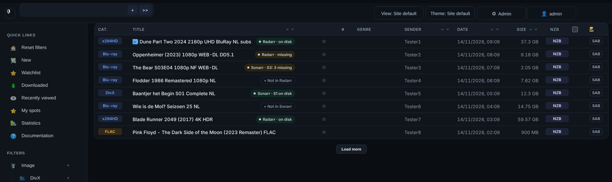

| Toevoegen aan Radarr | Instellingen |
|---|---|
| 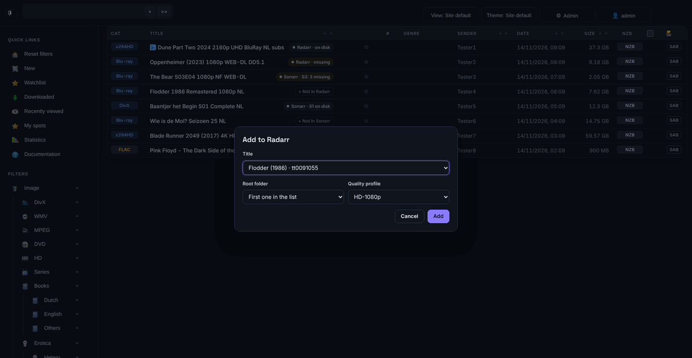 | 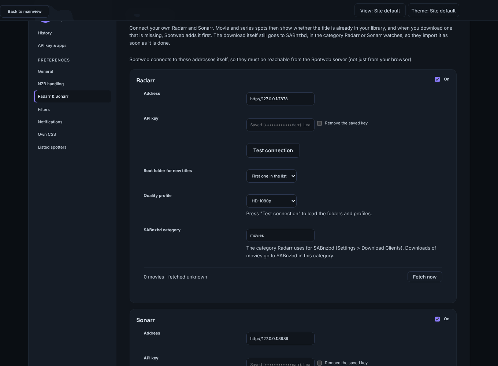 |

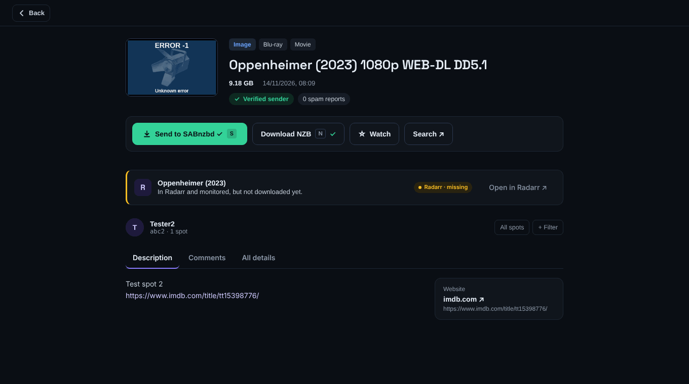

## 11. E-mail: eigen SMTP-server en wachtwoordherstel

- Je **eigen SMTP-server** met STARTTLS of SSL/TLS, inloggen,
  certificaatcontrole en optioneel **DKIM**-ondertekening.
- Een knop **Testmail versturen** die bij een fout het hele gesprek met de
  mailserver laat zien.
- Pagina **Wachtwoord vergeten** met een ondertekende link die één keer
  werkt (60 minuten geldig).
- Welkomstmail met een link om zelf een wachtwoord te kiezen, in plaats van
  een wachtwoord in de mail.

Details: [email.md](email.md).

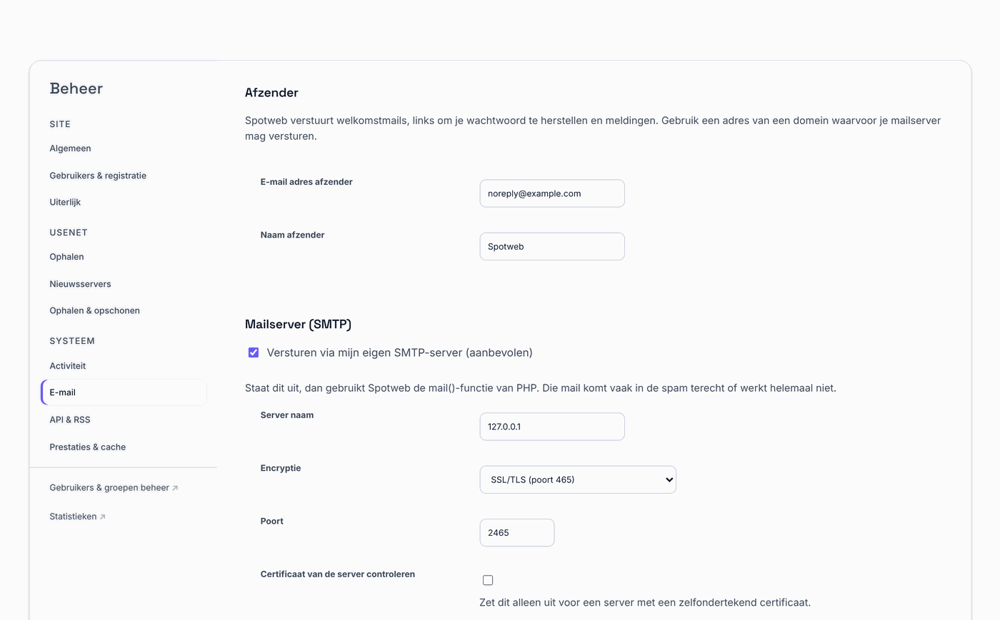

| Testmail | Herstelmail | Wachtwoord vergeten (telefoon) |
|---|---|---|
| 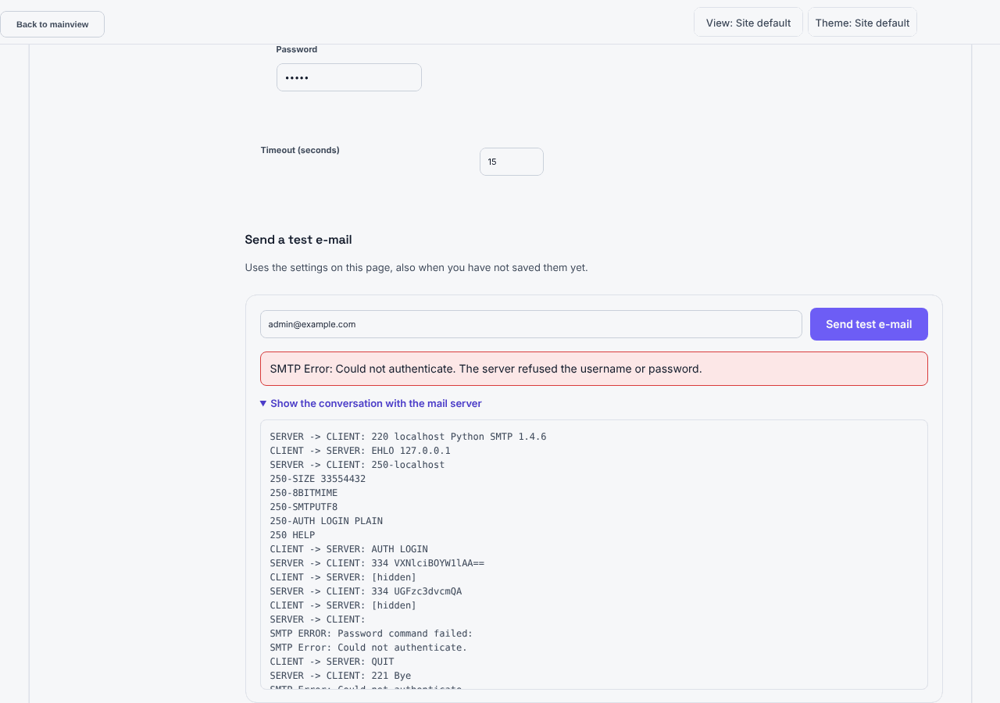 | 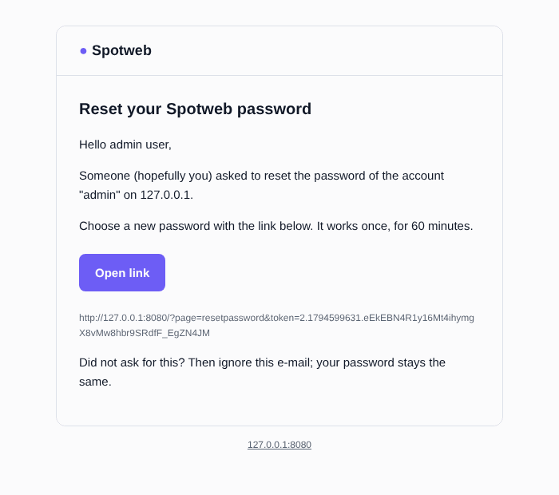 | 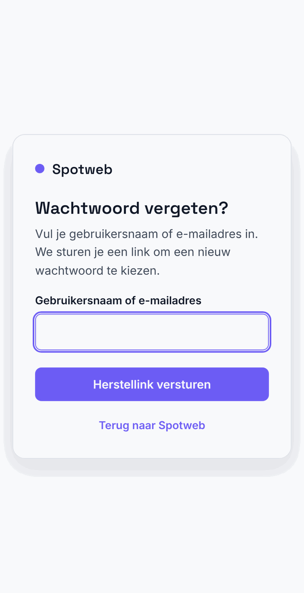 |

## 12. Over & updates: productie- en testkanaal

*Beheer → Over & updates* toont versie, build (git-commit), kanaal en
PHP-versie, en:

- **Controleert op updates** via GitHub en laat de nieuwe wijzigingen zien.
- **Updatet vanuit de browser**, inclusief de database-upgrade, met back-up
  en terugdraaien. Werkt met git, of zonder (ZIP-download) op servers waar
  `exec` uitgeschakeld is.
- Wisselen tussen **Productie** (`main`, getest) en **Test** (`develop`,
  nieuwste wijzigingen).

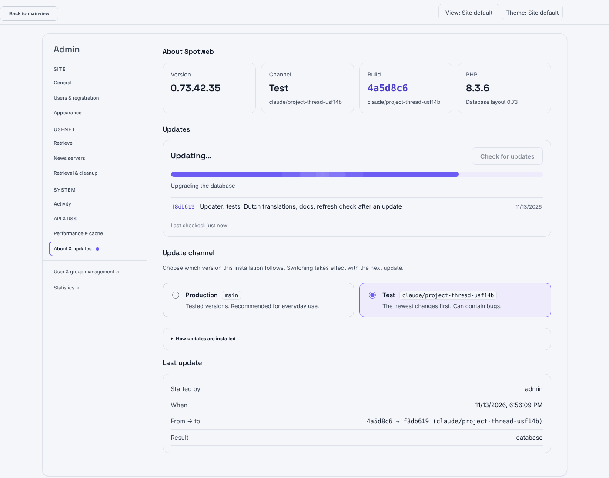

## 13. Onder de motorkap

- Geschikt voor **PHP 8.5**, waarschuwingen opgeruimd.
- MySQL/MariaDB-schema op **InnoDB / utf8mb4** (uit de upstream Spotweb).
- Database-instellingen kunnen **buiten de webroot** staan (of in omgevingsvariabelen).
- Werkt goed **achter Cloudflare** en andere proxies: echt bezoekers-IP,
  HTTPS-detectie, geen caching van persoonlijke pagina's of foutpagina's
  (zie [webserver.md](webserver.md)).
- Foutpagina's geven `503` met `no-store`, zodat een proxy ze nooit bewaart.
- Standaard Engels, volledig vertaald naar het **Nederlands**.
